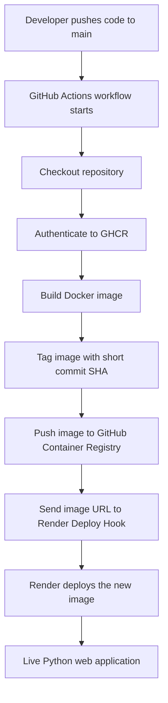

# ShipIt App 🚀

A lightweight Python web application packaged with Docker and deployed automatically through GitHub Actions, GitHub Container Registry (GHCR), and Render.

The project demonstrates a practical container-based CI/CD workflow: a change pushed to `main` triggers an automated Docker image build, publishes a versioned image to GHCR, and asks Render to deploy that exact image.

<p align="center">
  <strong>Python · Docker · GitHub Actions · GitHub Container Registry · Render</strong>
</p>

## Live application

**Production URL:** https://shipit-app-v1.onrender.com

The application responds to HTTP GET requests with a simple HTML page confirming that it has been shipped automatically by GitHub Actions.

## Project overview

This project was built to practise and demonstrate the path from application code to a running container in a hosted environment. Rather than manually building and deploying every change, the workflow automates the release process.

### What I implemented

- Built a minimal web server in Python using the standard-library `http.server` module.
- Configured the server to listen on `0.0.0.0` and use the port supplied by the `PORT` environment variable, defaulting to `8080`.
- Created a Dockerfile using the lightweight `python:3.12-slim` base image.
- Containerised the application, copied the application into the image, exposed port `8080`, and configured the container startup command.
- Improved container security by running the application as the unprivileged `nobody` user rather than root.
- Added the Open Containers Initiative (OCI) source label to associate the image with this GitHub repository.
- Created a GitHub Actions deployment workflow that runs on every push to `main`, with a manual `workflow_dispatch` trigger as well.
- Configured the workflow to authenticate to GitHub Container Registry using the GitHub-provided `GITHUB_TOKEN`.
- Automated Docker image creation and publication to GHCR.
- Tagged each published image with the first seven characters of the commit SHA, making each build identifiable and traceable to its source revision.
- Automated the Render deployment request using a Render Deploy Hook and the published image URL.

## Architecture and deployment flow



The workflow can also be started manually from the **Actions** tab in GitHub using the `workflow_dispatch` event.

## Technology stack

| Technology | How it is used |
|---|---|
| Python 3.12 | Implements the HTTP web server |
| Docker | Packages the application and its runtime |
| Dockerfile | Defines the container image and startup configuration |
| GitHub Actions | Automates the build and deployment pipeline |
| GitHub Container Registry (GHCR) | Stores versioned Docker images |
| Render | Hosts the deployed container |
| Git | Tracks source changes and commit-based image versions |

## Repository structure

```text
shipit-app/
├── .github/
│   └── workflows/
│       └── deploy.yml    # CI/CD workflow
├── app.py                # Python HTTP server
└── Dockerfile            # Container image definition
```

## Application implementation

The server is intentionally lightweight and uses Python's built-in libraries, so no third-party Python packages are required.

For each GET request, it returns an HTML response containing:

- A confirmation message: **"Shipped automatically by GitHub Actions!"**
- A short description of the Docker and automated deployment setup.
- An HTTP `200` response and an HTML content type.

The server reads its listening port from the environment, which allows the hosting platform to provide the port at runtime.

## Docker implementation

The Docker image is based on `python:3.12-slim` to keep the runtime image lean.

The Dockerfile:

1. Sets `/app` as the working directory.
2. Copies `app.py` into the image.
3. Sets `PORT=8080` as the default.
4. Documents port `8080` with `EXPOSE`.
5. Switches to the non-root `nobody` user.
6. Starts the application with `python app.py`.

The image also includes an OCI source label pointing to this repository.

## CI/CD workflow

The workflow is defined in [`.github/workflows/deploy.yml`](.github/workflows/deploy.yml).

### Trigger conditions

- **Push:** Automatically runs when code is pushed to the `main` branch.
- **Manual:** Can be started manually with GitHub Actions' `workflow_dispatch` event.

### Pipeline stages

**1. Checkout**

Uses `actions/checkout@v4` to retrieve the repository source code on the GitHub-hosted Ubuntu runner.

**2. Authenticate with GHCR**

Uses `docker/login-action@v3` to authenticate to `ghcr.io`. The workflow uses the GitHub actor as the username and `secrets.GITHUB_TOKEN` as the password.

**3. Build and publish the image**

Builds the Docker image and tags it using this naming pattern:

```text
ghcr.io/<github-owner>/shipit-app:<short-commit-sha>
```

The image is then pushed to GitHub Container Registry. The generated image reference is exported through `GITHUB_ENV` for the deployment step.

**4. Trigger Render deployment**

Sends a request to the Render Deploy Hook and passes the GHCR image URL through the `imgURL` parameter. This tells Render which container image to deploy.

### Required GitHub configuration

The workflow expects the following secret to be configured in the repository:

| Secret | Purpose |
|---|---|
| `RENDER_DEPLOY_HOOK` | Render Deploy Hook URL used to trigger deployment |

The workflow also declares the permissions it needs:

- `contents: read` to check out the repository.
- `packages: write` to publish the container image to GHCR.

Keep deployment hooks and credentials in GitHub Actions secrets. Never commit them to source code.

## Deployment evidence

The repository's GitHub Actions history records a successful deployment workflow execution:

- **Workflow:** `deploy`
- **Run number:** 1
- **Trigger:** `push`
- **Branch:** `main`
- **Result:** `completed` / `success`
- **Commit:** `52d8216ca9ea5a15f6d0f29a35700dfa5c26f140`

Evidence and traceability:

- [View the successful GitHub Actions run](https://github.com/oluwaloseyiT/shipit-app/actions/runs/41979489672)
- [View the deployment workflow](.github/workflows/deploy.yml)
- [View the CI/CD implementation commit](https://github.com/oluwaloseyiT/shipit-app/commit/52d8216ca9ea5a15f6d0f29a35700dfa5c26f140)
- [View the live application](https://shipit-app-v1.onrender.com)

## Run locally

### Prerequisites

- Python 3.12 or later
- Docker (optional, for running the container)

### Run with Python

Clone the repository:

```bash
git clone https://github.com/oluwaloseyiT/shipit-app.git
cd shipit-app
```

Start the application:

```bash
python app.py
```

Open http://localhost:8080 in your browser.

To use a different port:

```bash
PORT=5000 python app.py
```

### Build and run with Docker

Build the image:

```bash
docker build -t shipit-app:local .
```

Run the container:

```bash
docker run --rm -p 8080:8080 shipit-app:local
```

Open http://localhost:8080.

## What this project demonstrates

Through this project, I gained practical experience with:

- Writing and packaging a Python web application.
- Building Docker images and understanding container startup configuration.
- Applying a basic container security practice by running as a non-root user.
- Configuring GitHub Actions triggers, jobs, permissions, and secrets.
- Authenticating to and publishing images in GitHub Container Registry.
- Using commit-based image tags for build traceability.
- Connecting a CI/CD workflow to a hosting provider's deployment hook.
- Automating container delivery from a Git push to a hosted application.
- Understanding how source control, container registries, automation, and hosting fit together in a deployment pipeline.

## Future improvements

Potential next steps for this project include:

- Add automated application tests and a health-check endpoint.
- Add image vulnerability scanning and dependency checks.
- Pin third-party GitHub Actions to commit SHAs.
- Add deployment notifications and clearer failure reporting.
- Add rollback documentation and a release strategy.
- Add a multi-stage Docker build if the application grows.

---

**Project:** ShipIt App  
**Author:** [Oluwatofunmi Oluwaloseyi](https://github.com/oluwaloseyiT)  
**Repository:** https://github.com/oluwaloseyiT/shipit-app  
**Live application:** https://shipit-app-v1.onrender.com

Built as a hands-on cloud, containerisation, and CI/CD learning project.
